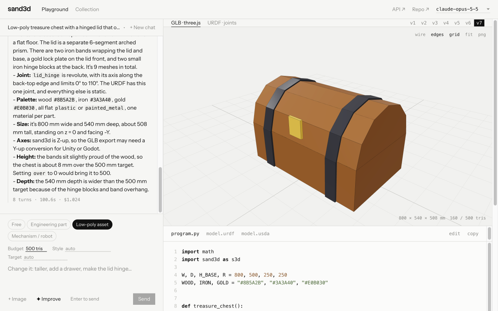

# sand3d-playground

Chat with Claude → get a 3D object built with [sand3d](https://github.com/Sandflow-ai/sand3d).



## Requirements

| Tool | Why |
| --- | --- |
| Node 22+ | UI + API server |
| [uv](https://docs.astral.sh/uv/) | Python 3.13 env for sand3d + Blender `bpy` |
| Claude Code login **or** `ANTHROPIC_API_KEY` | Agent SDK auth |

## Claude Code setup

| Step | Command |
| --- | --- |
| 1. Install Claude Code | `curl -fsSL https://claude.ai/install.sh \| bash` |
| 2. Log in (opens browser) | `claude` → `/login` |
| 3. Check it works | `claude -p "say hi"` |
| Alternative: API key instead of login | `export ANTHROPIC_API_KEY=sk-ant-...` |

- The app reuses that login automatically. No config file needed.
- Your own `CLAUDE.md`, hooks, plugins and MCP servers are **ignored** (`settingSources: []`).
- Claude can only call `build_model`, `WebSearch`, `WebFetch`.
- Model is picked in the top-right dropdown.
- Cost per turn is shown under each reply.

## Run

```bash
cd engine && uv sync && cd ..   # Python 3.13 + sand3d + bpy
npm install
npm run dev                     # API :8787 · UI http://localhost:5173
```

| Env var | Default | Effect |
| --- | --- | --- |
| `PORT` | `8787` | API port |
| `NODE_ENV=production` | — | set by `npm start`; serves `dist/` (run `npm run build` first) |

## Features

| Feature | Where |
| --- | --- |
| Chat → sand3d program → Blender build → render → self-fix | left panel |
| GLB preview (wire / edges / grid / PNG) | `GLB · three.js` tab |
| Joint sliders | `URDF · joints` tab |
| Program / URDF / USDA, hand-editable | under the preview |
| Every build kept, switchable | `v1 … vN` |
| Downloads | `↓GLB ↓URDF ↓USDA ↓STL ↓PY` |
| Chat history | chat title `▾` · link `/?chat=<id>` |
| Image input | `+ Image` |
| Prompt rewrite into a full brief | `✦ Improve` (guesses marked "(assumed)") |
| Browse + rebuild the HF sand3d collection | `Collection` (`/explore`) |

## Modes

| Mode | Options | Checks after each build |
| --- | --- | --- |
| Free | — | — |
| Engineering part | process, material | overall size |
| Low-poly asset | triangle budget, style, target | tris vs budget |
| Mechanism / robot | actuation, target | joint list |

## Layout

| Path | What |
| --- | --- |
| `server/agent.ts` | Agent SDK `query()` + in-process MCP tool `build_model(code)` |
| `server/prompt.ts` | system prompt (sand3d `docs/api.md` + `docs/guidelines.md`) |
| `server/modes.ts` | mode rules, option chips, post-build checks |
| `server/store.ts` | chat persistence |
| `engine/run.py` | runs `build()` → GLB / URDF / USDA / STL + workbench PNG |
| `src/` | React + Vite + three.js + `urdf-loader` |
| `runs/<chat>/v<n>/` | build outputs |
| `runs/<chat>/session.json` | saved chat |
